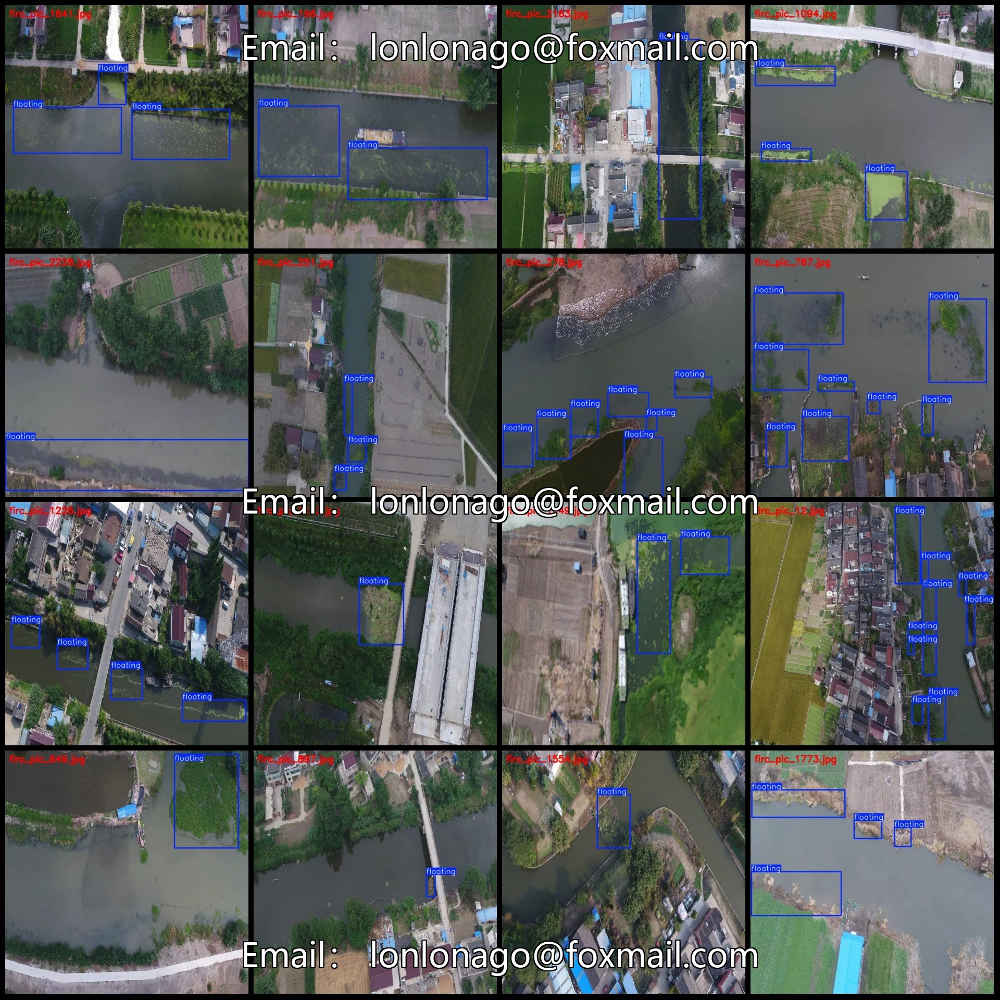
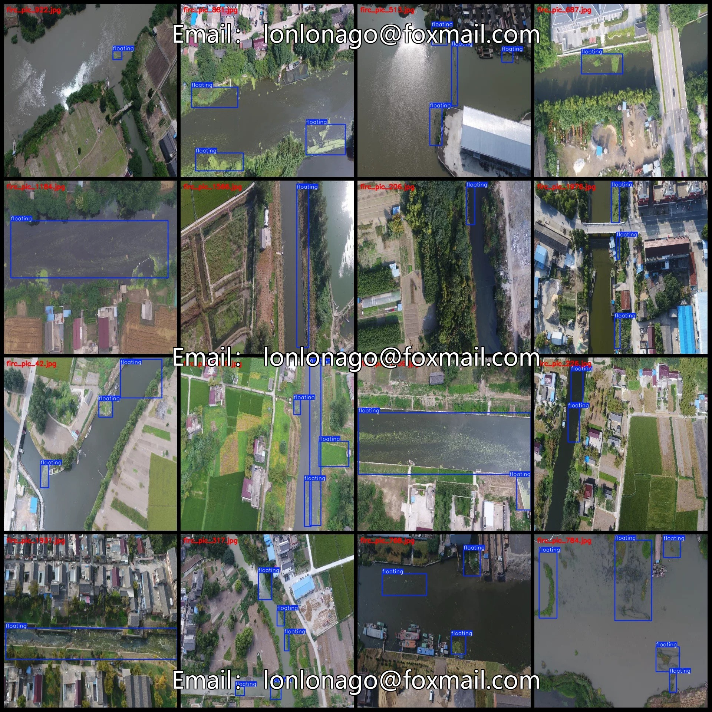
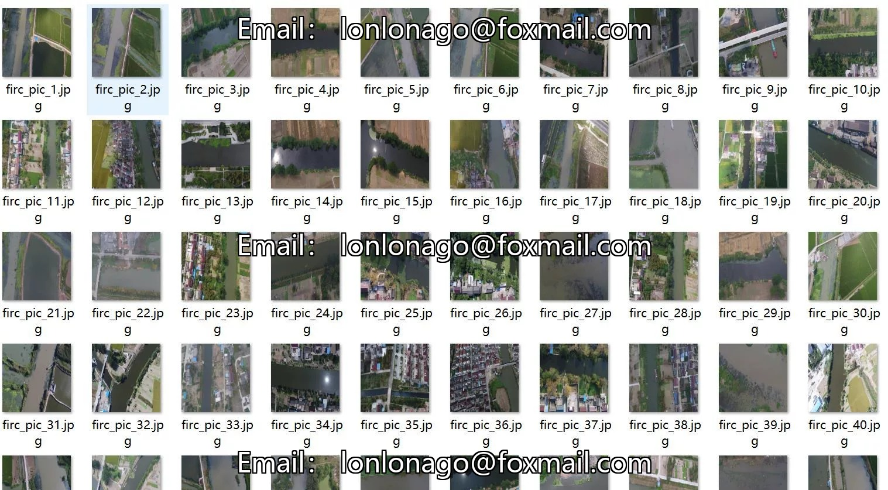
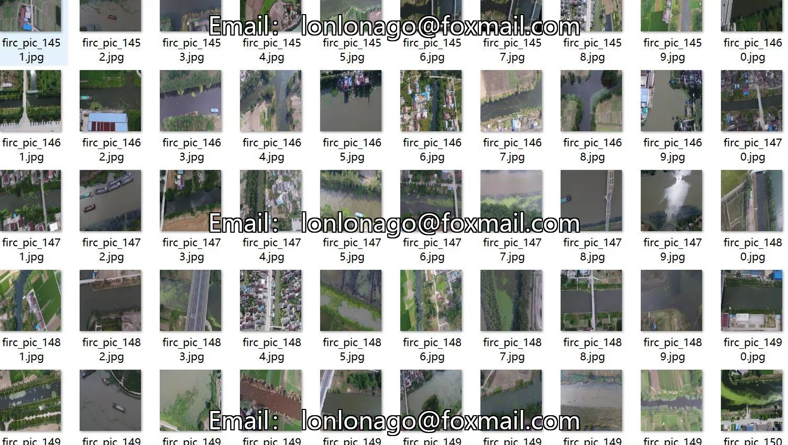
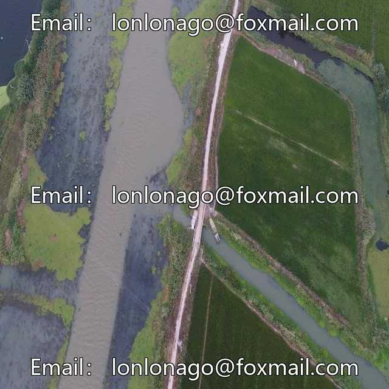
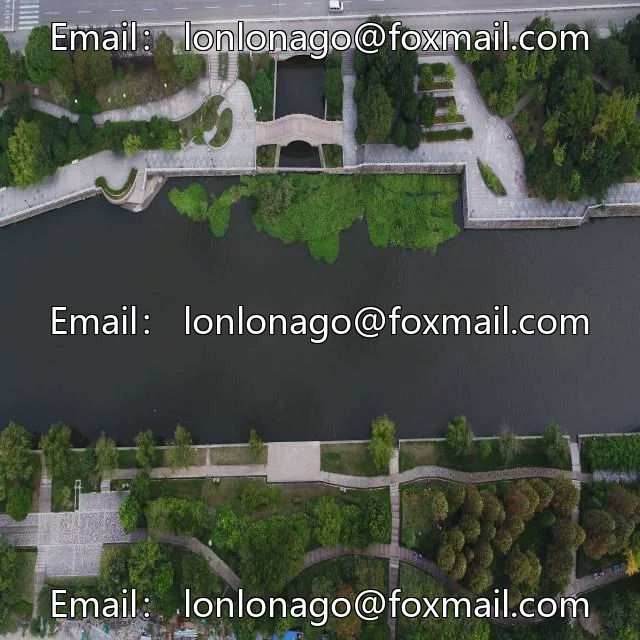
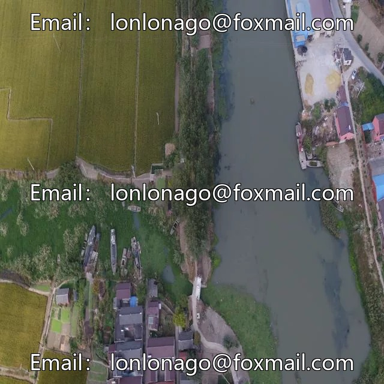

# UAV aerial photography river channel pollution floating debris garbage detection dataset VOC+YOLO format 2

## Body

Drone aerial photography dataset for river channel pollution floating debris detection in VOC+YOLO format with 2436 images in one category
Warm reminder: Due to the dataset's replicability, please confirm compliance before purchasing.
Dataset format: Pascal VOC format + YOLO format (txt file without split path, only contains jpg images and corresponding VOC format xml files and yolo format txt files)
Number of images (number of jpg files): 2436
Number of annotations (number of xml files): 2436
Number of annotations (number of txt files): 2436
Label category count: 1
Annotation Category Name: ["floating"]
Number of boxes and the number of images occupied by each category

Number of floating boxes = 5647, occupied by images = 2436
Total number of boxes: 5647
Image resolution: 640x640
Labeling tool used: labelImg
Labeling rules: Draw a rectangle around the category.
Important note: The dataset does not have separate training, validation, and test sets; you need to partition them yourself.
Special declaration: This dataset does not guarantee the accuracy of the trained models or weight files.

## Images

## Payment

Here is a pay link on Stripe ( https://buy.stripe.com/3cs8yP7sY87d0vu9AB ). Please contact me lonlonago@foxmail.com after funding $89, and I will send you a complete data files , thank you!

